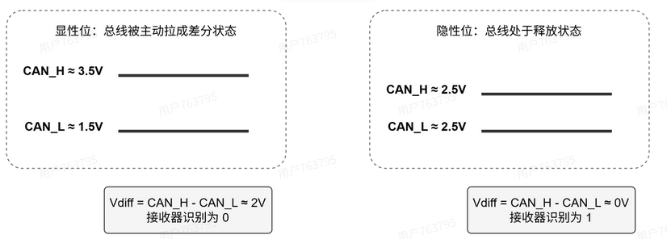
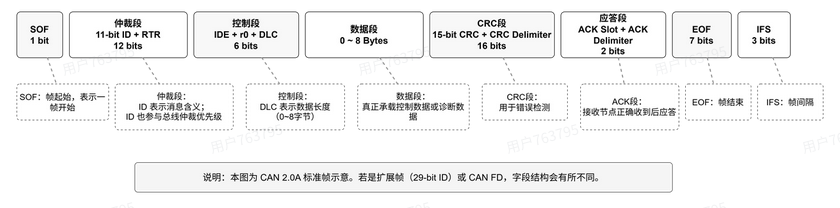

# CAN 通信：仲裁、错误处理与位时序

CAN 允许多个节点共享总线。理解它的关键，是把三个问题串起来：多个节点同时发送时谁先发，报文出错后怎样处理，以及所有节点怎样在正确的时刻采样。

本文讨论**经典 CAN（CAN 2.0）**，数据段最多 8 字节；时序配置以 STM32 的 bxCAN 为例。

## 物理层：显性为什么能覆盖隐性

高速 CAN 使用 CAN_H、CAN_L 两根差分信号线，接收器根据两线的电压差判定位值。差分传输有助于抑制共模干扰，但通信距离仍受波特率、线缆和收发器延迟限制。

图中电压是典型示意值。**显性对应逻辑 0，隐性对应逻辑 1**：只要有节点驱动显性，总线就呈现显性；所有节点都释放总线时，才呈现隐性。仲裁、ACK 和主动错误标志都利用了这个特性。

高速 CAN 总线两端通常各接一个 120 Ω 终端电阻，用于匹配线缆阻抗、减少反射，不是在每个节点上都接一个。

## 帧结构与仲裁

### 数据帧里有什么

| 帧类型 | 帧起始 | 仲裁段                                          | 控制段                           |  数据段   |        CRC        |        ACK        |           EOF+IFS              |
| ------ | -----| ---------------------------------------------  | ------------------------       | -------- | ---------------  | ------------------| ------------------------------------ |
| 标准帧 | 显性0 | id(11 bite) + RTR                              | IDE(显性0) + r0 + DLC(4 bite)   | 0~8 byte | 15bite+界定符(1 bite)| 槽 + 界定符(隐性1) |EOF(7 bite 隐性1)+IFS(3 bite 隐性1) |
| 拓展帧 | 同上 | id(11 bite)+SRR(隐性1)+IDE(隐性1)+id(18 bite)+RTR| r1 + r0 +DLC(4 bite)            | 同上     | 同上                 | 同上               | 同上                              |

RTR 区分数据帧和远程帧，分别为显性和隐性；IDE 区分标准格式和扩展格式，分别为 0 和 1。DLC 表示数据长度，经典 CAN 的数据段上限为 8 字节。

图中的 IFS 表示帧间隔，不属于数据帧本身。其中 Intermission 至少包含 3 个隐性位；总线空闲时可以继续保持隐性。

远程帧用来请求相同 ID 的数据帧，RTR 为隐性，没有数据段，DLC 表示请求的数据长度。是否响应、由哪个节点响应，需要通信双方约定。

### 同时发送时，谁继续发送

节点在发送时也读取总线。仲裁期间，若自己发送隐性 1，却读到显性 0，就停止发送并转为接收，让获胜节点继续完成报文。这是正常的仲裁失败，不是通信错误。

同一帧格式下，ID 按高位到低位参与比较，数值较小的 ID 优先级较高。ID 标识的是报文，不能直接等同于节点地址。同一 ID 的数据帧与远程帧竞争时，数据帧通过显性的 RTR 获胜。

**SRR 的作用是协调标准帧与扩展帧的仲裁。** 扩展帧在标准帧 RTR 所在位置发送隐性的 SRR，随后发送隐性的 IDE。当前 11 位 ID 相同时：

- 标准数据帧在 RTR 位置获胜；
- 标准远程帧在 RTR/SRR 位置打平，随后通过显性的 IDE 获胜。

扩展帧自己的 RTR 放在完整 29 位 ID 后面，供同 ID 的数据帧与远程帧仲裁。

### ACK 确认了什么

发送方在 ACK 槽发送隐性位，正确接收的节点将它拉为显性。发送方若仍读到隐性，就检测到 ACK 错误。

ACK 只说明有其他节点在协议层正确接收，不能证明指定节点已经处理了数据；ACK 之后还需完成帧尾检查。帧出错后的自动重发，也取决于控制器是否启用了该功能。

## 位填充与错误处理

### 为什么每五个相同位要插入一个反向位

持续不变的电平缺少同步边沿，节点的时钟误差会逐渐积累。因此，从 SOF 到 CRC 序列结束，发送器每连续发送 5 个相同位，就插入一个相反的填充位；接收器按同样规则移除它。

CRC 界定符、ACK 段和 EOF 不参与这段位填充。填充位占用传输时间，但不属于有效数据。

### 五类错误与错误标志

| 错误 | 判断依据 |
| --- | --- |
| 位错误 | 节点发送的位与回读电平不一致 |
| 填充错误 | 填充区间出现连续 6 个相同位 |
| CRC 错误 | 接收方计算的 CRC 与收到的 CRC 不一致 |
| 格式错误 | 固定格式字段出现非法位值 |
| ACK 错误 | 发送方在 ACK 槽没有读到显性位 |

发送与回读不一致有正常例外：仲裁期间发隐性、读显性表示仲裁失败；ACK 槽被接收方拉为显性表示确认；被动错误标志中的隐性位也可以被显性覆盖。

位、填充、格式和 ACK 错误通常在检测后的下一位开始发送错误标志。**CRC 错误则在 ACK 界定符之后开始报告**，除非已经因其他错误开始报错。因此 ACK 错误与 CRC 错误的报告时刻不同。规则见 [Bosch CAN 2.0，Part B §7](https://tech-tools.com/files/can2spec.pdf)。

| 错误标志 | 组成 | 对其他节点的影响 |
| --- | --- | --- |
| 主动错误标志 | 6 个显性位 | 破坏当前帧的填充或固定格式，使其他节点检测到错误 |
| 被动错误标志 | 6 个隐性位 | 不主动覆盖其他节点的显性位，不能保证让全网作废该帧 |

错误标志之后是 8 位隐性的错误界定符。多个节点先后报错时，主动错误标志会叠加，总线上的显性序列可达 6～12 位；其他节点可能因填充错误或格式错误跟随报错，并非都要等满 6 位才发现异常。

过载帧也使用 6 位显性标志和 8 位隐性界定符，但它用于推迟下一帧，不撤销上一帧。协议规定的触发条件包括接收器内部需要延迟，以及帧间间歇前两位检测到显性等情况。不能仅凭“中断没处理完”就推断控制器一定发送过载帧。

### TEC、REC 与故障隔离

TEC 是发送错误计数器，REC 是接收错误计数器。常见变化如下，不能把它们当成没有例外的计分公式。

| 情况 | 常见计数变化 |
| --- | --- |
| 发送方发送错误标志 | TEC 加 8 |
| 接收方检测到错误 | REC 加 1 |
| 接收方发完错误标志后的第一位仍为显性 | REC 额外加 8 |
| 成功发送完整一帧 | TEC 减 1，最低为 0 |
| 成功接收一帧 | REC 为 1～127 时减 1；大于 127 时设为 119～127 内的值；为 0 时保持不变 |

发送方没有“错误标志后第一位为显性就再加 8”的对称规则。持续显性、错误标志期间的位错误等情况另有计数条件。因此，仅知道“部分接收方 CRC 错误”，不足以固定推出各节点一定加多少分。

| 状态 | 进入条件 | 行为 |
| --- | --- | --- |
| 错误主动 | TEC、REC 均小于 128 | 正常参与通信，发现错误时可发主动错误标志 |
| 错误被动 | TEC 或 REC 达到 128，且未 Bus-off | 仍可收发，只能发被动错误标志；作为上一帧发送方，再次发送前需额外等待 8 个隐性位 |
| Bus-off | TEC 达到 256 | 退出总线通信，不发送报文或 ACK |

错误被动节点在 TEC、REC 都回到 128 以下时恢复主动。Bus-off 的协议恢复条件包括检测到 128 次、每次 11 个连续隐性位，恢复后计数器清零；实际是否自动启动恢复流程，还取决于控制器配置。

另一个常见例外是：错误被动发送方只检测到 ACK 错误，且被动错误标志期间没有检测到显性位时，TEC 不再因这次 ACK 错误增加。完整条件见 [Bosch CAN 2.0，Part B §8](https://tech-tools.com/files/can2spec.pdf)。

## 位时序：波特率相同，还要看采样点

一个 CAN 位由同步段、传播段、相位缓冲段 1 和相位缓冲段 2 组成。同步段固定为 1 个时间量子（$T_q$）；传播段补偿传输延迟，相位缓冲段用于重同步调整。

STM32 bxCAN 将传播段与相位缓冲段 1 合并为 BS1，采样点位于 BS1 结束处。SJW 表示一次重同步允许调整的最大宽度，需结合芯片限制设置。配置定义见 [ST：bxCAN 位时序配置](https://community.st.com/stm32-mcus-60/can-bxcan-bit-time-configuration-on-stm32-mcus-135466)及芯片参考手册。

设 CAN 外设时钟为 $f_{\mathrm{CAN}}$，实际分频系数为 $P$，BS1、BS2 的数值以 $T_q$ 为单位，则：

$$
T_q = \frac{P}{f_{\mathrm{CAN}}}, \qquad
N_{Tq} = 1 + \mathrm{BS1} + \mathrm{BS2}
$$

$$
\text{波特率} = \frac{f_{\mathrm{CAN}}}{P(1+\mathrm{BS1}+\mathrm{BS2})}
$$

$$
\text{采样点} = \frac{1+\mathrm{BS1}}{1+\mathrm{BS1}+\mathrm{BS2}} \times 100\%
$$

## CAN FD

### 结构对比
经典帧:   SOF | ID | RTR | IDE r0 | DLC | 数据0~8 | CRC15/17 | ACK | EOF
FD帧:    SOF | ID | RRS | IDE FDF res | BRS ESI DLC | 数据0~64 | CRC17/21+SC | ACK | EOF
              └──── 仲裁段(低速) ────┘         └─ 数据段(可高速) ─┘
拓展FD帧：SOF | ID | RRS | IDE ID FDF res | BRS ESI DLC | 数据0~64 | CRC17/21+SC | ACK | EOF

### 新增控制位
- FDF / EDL(经典帧中的R0)
    隐性 = 这是 FD 帧；显性 = 经典帧；

- RRS（取代 RTR,恒为显性）
    含义：FD 取消了远程帧,FD 帧一律是数据帧。

- BRS（Bit Rate Switch，波特率切换）
    隐性 = 从这一位之后切换到数据段波特率；显性 = 整帧都用仲裁段速率；
    切换点精确地说：BRS 位本身仍按仲裁段速率发，从它之后的位开始提速，一直用到 CRC 界定符，再降回低速收尾。

- ESI（Error State Indicator）
    发送节点用它广播自己的健康状态：显性 = 我处于错误主动；隐性 = 我已进入错误被动；

### 经典CAN和CAN FD的区别
| 维度   |     经典CAN     |        CAN FD            | 
| ---    | -----------   | ------------------------  |
| 数据长度 |   0~8 字节    |	0~64 字节（阶梯编码）     |
速率	  |  全程 ≤1 Mbps |	 仲裁段 ≤1M + 数据段 2~5M+   |
远程帧	   |     有       |     取消（RRS 恒显性）        |
CRC	     |    15 位      |  17/21 位 + Stuff Count    |
错误状态  |   外部不可见   |       ESI 位广播             |
兼容	  |    	 —       | 可发经典帧，不能与经典节点混网  |

### 42 MHz 时钟配置 1 Mbit/s

首先计算分频系数与每位时间量子数的乘积：

$$
P \times N_{Tq} = \frac{42\ \mathrm{MHz}}{1\ \mathrm{Mbit/s}} = 42
$$

选取 $P=3$、$N_{Tq}=14$，于是 $\mathrm{BS1}+\mathrm{BS2}=13$。以下两组配置都满足目标波特率：

| 分频系数 | BS1 | BS2 | 采样点 |
| --- | --- | --- | --- |
| 3 | 11 | 2 | $12/14 \approx 85.7\%$ |
| 3 | 10 | 3 | $11/14 \approx 78.6\%$ |

它们是候选参数，实际选用还要检查线缆与收发器延迟、时钟误差及 SJW，不能只根据采样点比例判断“必然稳定”。

手动写 bxCAN 的 `CAN_BTR` 时，BRP、TS1、TS2 字段采用“实际值减 1”的编码；使用 HAL 等接口时则应遵循接口定义，不要再次手动减一。比如实际分频为 3、BS1 为 11、BS2 为 2，对应的寄存器字段值分别为 2、10、1。定义可查 [STM32F4 参考手册 RM0090 的 bxCAN 章节](https://www.st.com.cn/resource/en/reference_manual/dm00031020-stm32f405415-stm32f407417-stm32f427437-and-stm32f429439-advanced-armbased-32bit-mcus-stmicroelectronics.pdf)。

[返回：嵌入式学习](/notes/EmbeddedLearningOverview)
