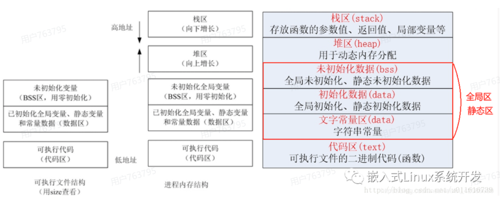

# C 语言变量存在哪里：栈、静态区与堆

调试器显示一个变量地址时，不能只看它是不是局部变量，还要结合编译结果和内存布局判断。变量定义方式决定了它通常存在哪里、什么时候失效。

## 不同变量的存储位置

| 定义方式 | 常见存储位置 | 空间何时有效 |
| --- | --- | --- |
| 普通局部变量 | 寄存器或当前函数的栈帧 | 通常到本次函数执行结束 |
| 局部 `static` 变量 | 静态存储区 | 整个程序运行期间 |
| 文件级变量 | 静态存储区 | 整个程序运行期间 |
| `malloc()` 返回的对象 | 堆 | 从分配成功到释放 |

在常见 MCU 程序中，有非零初值的全局或 `static` 变量通常放在 `.data` 对应的 RAM 区域，初值由启动代码从 Flash 复制；未初始化或零初始化的变量通常放在 `.bss`，启动时清零。实际布局以链接脚本和 map 文件为准。

普通局部变量不一定有内存地址。优化后，它可能始终保存在寄存器中，调试器因此显示 `<optimized out>`。如果程序确实需要访问它的地址，编译器才会为它安排可寻址的存储位置。

## C语言内存划分



为什么要分.data段和.bss段？​
在程序编译的时候，不会给.bss段中的数据分配空间，只是记录数据所需空间的大小。在程序执行的时候，才会给.bss段中的数据分配内存。通过这种方式，可以节省一部分内存空间，进一步缩减可执行程序的大小。

## 取地址不等于必须改成全局变量

下面的写法完全正常：

```c
void read_value(void)
{
  int value;
  scanf("%d", &value);
  use_value(value);
}
```

`&value` 只在函数执行期间使用，`scanf()` 返回后不再保留这个指针。函数结束时 `value` 失效，但不会留下指向它的外部指针，因此没有必要改成全局变量。

真正有问题的是让指针比变量活得更久：

```c
int *bad(void)
{
  int value = 5;
  return &value;
}
```

函数返回后，`value` 的栈空间可以被后续调用复用。返回的指针仍指向旧地址，但已经不再指向有效对象，继续访问会产生未定义行为。

## 异步操作更关心缓冲区何时失效

DMA 和中断驱动的接口可能在函数返回后继续访问缓冲区：

```c
void start_receive(void)
{
  unsigned char buffer[16];
  HAL_UART_Receive_DMA(&huart1, buffer, 16);
}
```

如果启动函数立即返回，而 DMA 尚未完成，`buffer` 的栈空间就可能被其他调用复用。任务切换本身不会让任务栈失效，真正的问题是函数返回、任务删除或缓冲区被再次使用。

可以根据使用方式选择：

- 在等待传输完成后再返回，继续使用局部缓冲区。
- 使用生命周期足够长的静态缓冲区，并避免多个操作同时覆盖它。
- 动态分配缓冲区，在传输完成后按约定释放。
- 让调用方提供缓冲区，由调用方保证它在整个操作期间有效。

因此，判断标准不是“有没有取地址”，而是**地址最后一次被使用时，变量是否仍然有效**。随意改成全局变量虽然延长了生命周期，也会增加共享状态和 RAM 占用。

[extern 与 static](/notes/CExternStatic) · [对象生命周期与资源管理](/notes/CObjectLifecycle) · [返回：C 语言学习](/notes/CLearningOverview)
