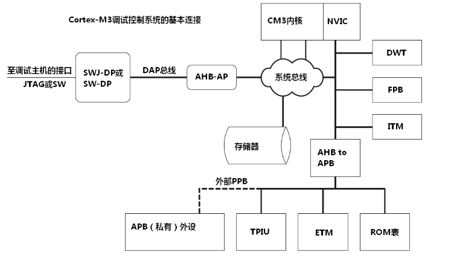

# Cortex-M 调试：断点、观察点与跟踪

调试功能可以按是否打断程序运行来分类。断点和单步适合检查确定位置的控制流，跟踪则更适合观察实时程序的运行过程。

## 会打断程序运行的调试

常见的侵入式操作包括：

- 停机、单步执行，以及读写内核和外设寄存器。
- 硬件断点：由调试硬件比较 PC，命中指定指令地址后暂停，不需要修改 Flash 中的指令。
- 软件断点：调试器把目标指令替换为 `BKPT`，程序执行到该处后进入调试流程。
- 数据观察点：监视一个地址或地址范围，也可结合数据值设置条件，在指定读写发生时暂停。
- 调试监视器异常：由调试监控代码接管调试事件，具体行为取决于系统实现。
- Flash patching：利用硬件地址重映射，把 Flash 中的访问替换到补丁位置，可用于基于 ROM 的代码修补和调试。

这些操作会改变程序原有的执行时序。调试通信、电机控制等实时任务时，暂停内核还可能引入额外现象。

## 程序运行时能观察什么

非侵入式调试尽量让内核继续运行，同时收集信息：

- 通过调试访问端口读写存储器。是否影响总线和实时性，取决于芯片与访问方式。
- 使用 DWT 的数据观察点和跟踪功能记录指定数据访问、事件或性能统计信息。
- 使用 ITM 输出软件跟踪信息。ITM 是 Instrumentation Trace Macrocell，软件向 stimulus 端口写入数据，再由调试硬件送出，常用于轻量日志和事件记录。
- 使用可选的 ETM 跟踪指令执行流。ETM 是 Embedded Trace Macrocell，并非所有 Cortex-M 芯片都提供。

ITM 主要记录软件主动写出的信息，ETM 主要记录指令流，两者不能互相替代。可用的跟踪通道、引脚和带宽还取决于具体芯片与调试器。

[下一篇：STM32 启动与烧录](/notes/STM32BootAndFlashing) · [返回：嵌入式学习](/notes/EmbeddedLearningOverview)
