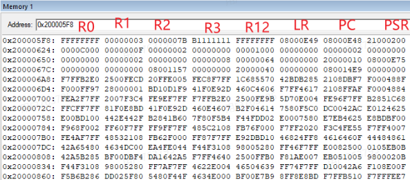
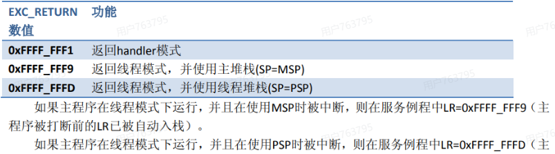

# HardFault 定位：从堆栈找到出错指令

非法访存、未对齐访问等问题可能触发 HardFault。定位时先找到异常自动保存的栈帧，再读取其中的 PC，而不是只查看 HardFault 处理函数当前的调用位置。

## 异常栈帧保存了什么

以常见 Cortex-M3/M4 的基本栈帧为例，异常进入时硬件保存 8 个寄存器。按地址从高到低排列为：

| 栈帧内容 | 定位时的作用 |
| --- | --- |
| xPSR | 保存程序状态 |
| PC | 通常指向触发异常或异常发生时应继续执行的指令，是首要定位线索 |
| LR | 保存被打断代码的链接寄存器值，可辅助回溯调用关系 |
| R12、R3、R2、R1、R0 | 保存出错前的通用寄存器现场 |

**栈帧里的 LR 是异常前代码的 LR；异常进入时硬件写入 LR 的 `EXC_RETURN` 是另一个值。** `EXC_RETURN` 描述异常返回方式，不能把它当成出错代码的返回地址。

## 先确定使用哪个栈

进入 HardFault 后，读取当前 LR 中的 `EXC_RETURN`，根据其中指示返回栈的位选择被打断代码使用的栈：

- 返回后使用 MSP：从 MSP 指向的位置查找栈帧。
- 返回后使用 PSP：从 PSP 指向的位置查找栈帧。运行 FreeRTOS 时，任务通常使用 PSP。
在裸机或处理函数中，MSP 常用于内核和异常处理；在 RTOS 中不能默认所有出错现场都在 MSP 上。若进入 HardFault 后代码已经修改过 LR 或栈指针，应先保存入口处的值，再进行分析。

## 从栈帧地址找到 PC

基本栈帧中，若保存的 SP 指向最低的 R0 地址，则栈内 PC 位于 `SP + 7 × 4`。反汇编 PC 附近的指令，并结合栈内寄存器和故障状态寄存器，继续判断是地址错误、指令问题还是其他原因。

带 FPU 的 Cortex-M4 可能使用扩展栈帧，额外保存 S0–S15、FPSCR 及保留字。是否压入这些内容由异常进入时的浮点上下文决定，会影响基本栈帧的位置。硬件还可能为栈对齐插入额外空间，因此实际分析时应结合 `EXC_RETURN`、对齐标志和所用处理代码计算地址，不能机械套用固定偏移。

[上一篇：STM32 启动与烧录](/notes/STM32BootAndFlashing) · [下一篇：代码存储与 XIP](/notes/CodeStorageAndXIP) · [返回：嵌入式学习](/notes/EmbeddedLearningOverview)
